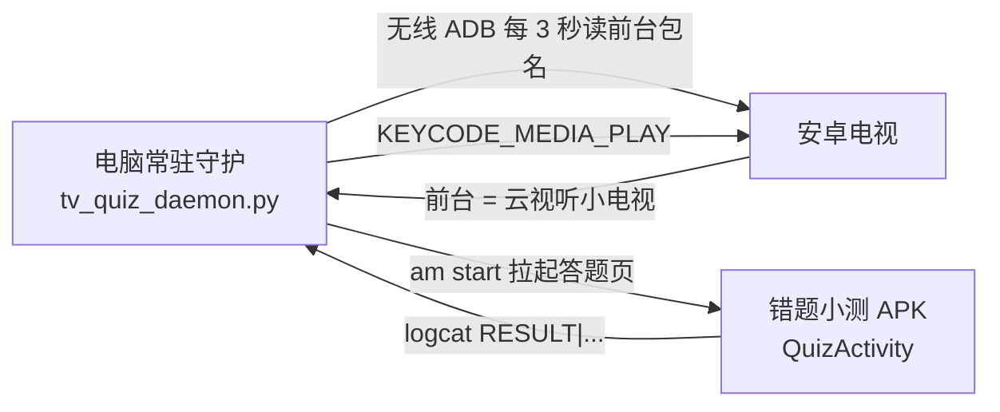

# 电视错题小测 tv-quiz

给家里的小米电视加一道「进门先答题」的闸门：孩子打开**云视听小电视**，先用遥控器做一道四选一，答完自动接着播放；之后每看 3 分钟再弹一道。

不用装输入法、不用长篇输入，方向键移焦点、确定键选 ABCD 即可。题目来自孩子自己的错题本，加上按五年级上册教材进度补充的语文、数学、英语题，共 85 道。

---

## 这是什么

一台常开的电脑当服务器，通过**无线 ADB**盯着电视的前台应用；电视上装一个很小的自研 APK 负责显示题目和记录作答。两边都不需要 root，不需要 Android Studio，不需要 Gradle，也不需要联网云服务。



一次完整的流程：

1. 守护发现前台切进 `com.xiaodianshi.tv.yst`（云视听小电视），设下「闸门」。
2. 拉起全屏答题页；没作答就反复拉回前台（APK 里拦了返回键，主页键也绕不过去）。
3. 孩子用遥控器选 A/B/C/D，结果写进 APK 的 logcat，守护抓回来存到 `answer_log.jsonl`。
4. 放行，发一次播放键让节目**继续播**（不额外暂停），开始累计观看时间。
5. 累计满 3 分钟再弹一道；退出云视听小电视就停表，回来重新计时。
6. 抽题按「答错过的、久没见的优先」加权，选项每次打乱顺序并重算正确答案位置。

另外，电视重启后系统常把「ADB 调试」关掉，导致整套机制静默失效。项目里做了三层自恢复，见下文 [ADB 自恢复](#adb-自恢复)。

---

## 目录结构

| 路径 | 说明 |
|---|---|
| `tools/tv_quiz_daemon.py` | **核心**：电脑端常驻守护，前台检测、闸门、计时、抽题、续播、断线告警 |
| `tools/build_tv_apk.py` | 不用 Gradle 的 APK 构建链：`aapt2 → javac → d8 → zipalign → apksigner` |
| `tools/setup_toolchain.py` | 自动下载 adb / JDK 17 / Android SDK build-tools 34 到 `toolchain/` |
| `tools/setup_adb_keeper.py` | 安装 APK、授予 `WRITE_SECURE_SETTINGS`、唤醒自恢复 |
| `tools/build_questions.py` | 把错题卡 + 教材题合并成 `questions.json` |
| `tools/check_adb.py`、`watch_reboot.py`、`test_adb_selfheal.py` | ADB 状态自检、重启监视、自愈实验 |
| `tools/cec_diag.py`、`watch_cec_boot.py` | HDMI-CEC 只读诊断、真实开机验收 |
| `tools/verify_live_gate.py` 等 | 真机端到端验证（进门题、续播、遥控器） |
| `android/` | 电视端 Java 源码与 `AndroidManifest.xml`，便于直接阅读 |
| `questions.json` | 85 道四选一题库；`quiz_items.json` / `textbook_items.json` 是改造表 |
| `preview.html` | 电脑上的题库预览页，方向键 + 回车可模拟遥控器 |
| `config.example.json` | 配置样例（**复制成 `config.json` 后使用**） |
| `windows/` | 三个通用 bat 模板，可直接放到项目根目录用 |

`android/` 里的 Java 源码是便于阅读的副本；`tools/build_tv_apk.py` 里内嵌了同一份可编译源码，构建时以内嵌版本为准。

---

## 快速开始

**前提**

- 一台 Android 电视（小米电视 / Android 9 已实测），和电脑在同一个局域网
- 电视：设置 → 帐号与安全 → **ADB 调试**打开；记下电视 IP
- 一台常开的电脑，Python 3.9+（Windows / Linux / macOS 均可）
- 不需要 root，不需要 Android Studio

**步骤**

```bash
git clone https://github.com/wujian1974/tv-quiz.git
cd tv-quiz

# 1. 配置：把 tv_ip 改成你电视的 IP（默认端口 5555）
cp config.example.json config.json

# 2. 装工具链（约几百 MB，只装到 toolchain/，不改系统环境）
python tools/setup_toolchain.py
python tools/verify_toolchain.py          # 可选：构建一个最小 APK 验证链路

# 3. 构建并安装电视端 APK
python tools/build_tv_apk.py              # 产物 apk/tvquiz.apk
python tools/setup_adb_keeper.py          # 安装 + 授权 + 唤醒自恢复

# 4. 电视上用「沙发管家」等把「错题小测」设为开机自启动

# 5. 启动守护（Windows 可直接用 windows/start_quiz.bat）
python tools/tv_quiz_daemon.py
```

第一次 `adb connect` 时电视会弹「允许 USB 调试」，勾上「一律允许」并确认。

想直接体验，**跳过第 2 步里的 `build_questions.py`**：仓库自带的 `questions.json` 已经包含 85 道题。只有想重新生成错题库部分时才需要运行 `tools/build_questions.py`，它会去读 `config.json` 里 `cards_dir` 指向的错题卡目录（这个目录属于私人数据，不随仓库公开）。

---

## 配置项

`config.json`（从 `config.example.json` 复制）里常用的几项：

| 配置 | 默认 | 说明 |
|---|---|---|
| `tv_ip` | — | 电视地址 `<IP>:5555`，**必填** |
| `bili_packages` | `["com.xiaodianshi.tv.yst"]` | 只对这些包名生效。注意 `com.bilibili.tv` 是另一个客户端，`com.chinasoul.bt` 是第三方 BT，需要的话自行加入 |
| `interval_minutes` | `5` | 每隔几分钟弹一道 |
| `gate_on_enter` | `true` | 每次进入都先做一道题 |
| `gate_cooldown_seconds` | `0` | 冷却按**上次答完题**算；调大（如 60）可避免短时间频繁进出反复弹题 |
| `gate_leave_grace_seconds` | `8` | 连续离开不足 8 秒不算真离开，用来过滤启动画面、播放器切屏的抖动 |
| `gate_require_correct` | `false` | 改成 `true` 则必须答对才放行（最多换 3 道题） |
| `resume_after_quiz` | `true` | 答完自动发播放键续播 |
| `pause_on_quiz` | `false` | 不额外发暂停键，切到答题页时播放器自己会停 |
| `offline_alert_seconds` | `90` | 断连超过这个秒数就报警，写 `STATUS.json` 并弹提示 |
| `adb_revive_via_assistant` | `true` | 用小米电视 6095 端口自动恢复 ADB；非小米 / Android TV 机型请关掉 |
| `adb_revive_after_offline_seconds` | `60` | 离线多久后启用 6095 通道 |
| `adb_revive_retry_seconds` | `60` | 6095 拉起重试间隔 |
| `cec_guard_enabled` | `true` | 防止功放开机把画面切到 HDMI 界面 |
| `cec_guard_after_reconnect_seconds` | `600` | 重连后多长时间内开启防切源保护 |
| `cec_guard_poll_seconds` | `12` | 检查 HDMI-CEC 活动源的间隔 |
| `textbook_units` | 五上语文 1-4 / 数学 1-4 / 英语 Unit1-3 | 教材题按单元限定「已学到哪儿」，进度往前走就往里加 |

> 一个踩过的坑：冷却期原先按「上次离开」算，结果电视在 B 站和桌面之间来回切时这个时间被不断刷新，正经的进门反而永远不弹题。现在改成按「上次答完题」算，并默认冷却为 0。

---

## 题库

`questions.json` 共 85 道四选一：

- **错题库 25 道**：原本是填空、计算、阅读、写话，逐题改造成 ABCD，干扰项优先取自孩子当初的真实错答；每题的 `opt_from` 字段记录了干扰项来源，方便家长抽查。
- **教材补充 60 道**：语文 20、数学 20、英语 20，按五年级上册已学单元编写。
- 合计数学 35、语文 30、英语 20；每次出题打乱选项顺序。
- 两道写话题标了 `open_ended: true`，答案是参考例文而非唯一解。

题目均为家庭学习用途的改编内容。如果要二次分发，请自行留意所依据教材资料的版权。

---

## ADB 自恢复

小米电视重启后，系统往往在开机约 1 分钟时把网络 ADB 再关一次，端口直接消失，电脑端再怎么重连都没用。项目用四层兜底：

1. **电视端 `AdbKeeper`**：监听 `BOOT_COMPLETED` / `QUICKBOOT_POWERON` / MIUI 开机广播，在开机后 20/60/120/180 秒把 `Settings.Global.ADB_ENABLED` 写回 1；之后每 5 分钟链式自检。需要 `WRITE_SECURE_SETTINGS`（用 `pm grant` 授予）。
2. **电脑端守护**：每次连上电视时发一次 `ADB_BOOTTEST` 广播唤醒接收器，之后每 10 分钟保活一次；断线自动重连。
3. **APK 自身**：每次打开答题页也会 `kick()` 一次自恢复。
4. **6095 通道（不依赖 ADB）**：小米/Redmi 电视在 6095 端口有独立的局域网控制服务。开机后即使 5555 完全拒绝连接，守护也会请求 `/controller?action=startapp` 把答题应用拉起来；应用一启动就把 `adb_enabled` 写回 1，ADB 自动回来。**这一层解决了「开机广播没赶上、守护又连不上」的死结**，全程不用人到电视上开开关。Android TV / Google TV 机型没有这个端口，把 `adb_revive_via_assistant` 设为 `false` 即可。

实测把 `adb_enabled` 写成 0 后约 18 秒自动恢复；一次完整重启中，端口在 +42 秒恢复、+61 秒被系统关掉、+110 秒自行回来，此后连续在线。2026-11-13 另一次开机中 5555 一直拒绝连接，靠 6095 拉起应用后 3 秒恢复。

`tools/watch_reboot.py --settle 180` 可以复现并监视整个过程；`tools/test_adb_selfheal.py --alarms-only` 是无风险的闹钟自检；`tools/cec_diag.py` 只读诊断电视的 HDMI-CEC / 输入源状态。

---

## HDMI-CEC 防切源

电视通过 HDMI ARC/eARC 接功放时，功放随电视开机后可能发出 `Active Source`，把画面自动切到功放所在的 HDMI 输入，家长还得手动退出来。项目做了两层处理：

- **设置层**：关闭系统里「通用设置 → 直接播放信号源」（对应全局键 `mitv.settings.db.video.auto_switch`）。CEC 总开关、`hdmi_control_auto_device_off_enabled`、系统音频控制与 ARC/eARC 音频都保留，所以功放仍会跟着电视开机并正常出声。这个键可能被系统还原，守护每次连上电视都会复查并写回 0。
- **兜底层**：守护在重连后的保护窗口内每 12 秒读一次 `dumpsys hdmi_control` 的 `mActiveRoutingPath`。只要活动源不再是电视自己（非 `0x0000`），就自动发 HOME 回电视桌面，不需要手动退出。

`tools/watch_cec_boot.py --wait 240` 会真实重启电视，逐次记录 ADB、CEC 活动源、功放电源状态和前台应用，用来验收这个行为。不需要就把 `cec_guard_enabled` 设为 `false`。

---

## 隐私与边界

这是脱敏后的开源版本，以下内容**不在仓库里**（`.gitignore` 采用白名单，默认忽略一切）：

- APK 签名私钥（`*.keystore`）、编译产物 APK
- 家里电视的内网 IP、设备型号序列号、已装应用清单
- 孩子的答题记录、运行日志、电视截图、录屏
- 从 ima 知识库抓取的教材原文与资料 ID
- 下载到本地的 JDK / Android SDK / adb 工具链（约 1.1 GB）

`config.json`、`STATUS.json`、`answer_log.jsonl`、`quiz_history.json`、`daemon.log` 等运行时文件都被排除。**首次使用请复制 `config.example.json` 为 `config.json`**，不要把真实 IP 提交上来。

---

## 已知限制

- 依赖电脑常开、电视和电脑在同一局域网；断网或电脑关机时闸门不生效。
- 这不是系统级家长控制，也不是防绕过方案：能进电视设置的人仍可以关掉 ADB 或卸载应用。
- 只针对 `bili_packages` 里列出的客户端；其他视频软件不拦截、不计时。
- 依赖无线 ADB 与 `WRITE_SECURE_SETTINGS`，不同品牌/版本的电视可能需要调整接收器与授权方式。
- `AdbKeeper` 依赖开机广播能被送到；若应用刚重装、开机时还在补做 dexopt，可能赶不上广播，此时由守护唤醒 + 5 分钟自检兜底。

---

## 验证

```bash
python tools/check_adb.py                        # ADB 通不通
python tools/verify_live_gate.py --rounds 2      # 真机：连续两次进门都弹题 + 自动续播
python tools/watch_reboot.py --wait 480 --settle 180   # 重启后 ADB 恢复全过程
python tools/cec_diag.py                              # 只读诊断 CEC / 功放 / 输入源
python tools/watch_cec_boot.py --wait 240             # 真实开机：功放联动 + 不自动切源
```

`preview.html` 可以直接在电脑浏览器里看题、用方向键 + 回车模拟遥控器。

---

## 许可

[MIT](LICENSE)
